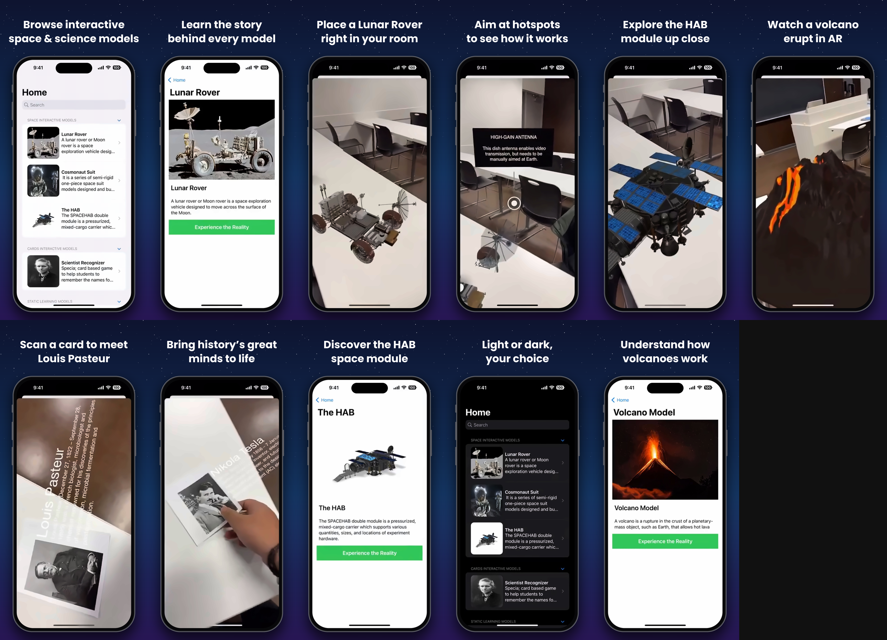

# RealityLab - AR Learning App

RealityLab is an iOS app that uses augmented reality (AR) to help people learn. It uses 3D models and image recognition to show space objects and information about scientists.

## Overview

The app has two main features:

1. **3D model viewer:** View space and science models in your surroundings.
2. **Scientist cards:** Point the camera at a scientist card to see information about that person.

## Features

### 3D Models

- **Lunar Rover:** Learn about a vehicle used on the Moon.
- **Cosmonaut Suit:** View a space suit used by astronauts.
- **HAB Module:** Explore a cargo module used in space missions.
- **Volcano:** Learn about volcanoes with a 3D model.

### Scientist Cards

The app can recognize cards with pictures of these scientists:

- Marie Curie (Physics)
- Albert Einstein (Physics)
- Isaac Newton (Mathematics)
- Charles Darwin (Biology)
- Galileo Galilei (Astronomy)
- Ada Lovelace (Mathematics)
- Mary Anning (Palaeontology)
- Louis Pasteur (Chemistry)
- Nikola Tesla (Engineering)

### Other Features

- Detects flat surfaces where you can place a model.
- Lets you tap the screen to place a model.
- Tracks scientist cards and shows information about each person.
- Lets you search for models.
- Shows loading progress while preview images load.

## Technologies

- **SwiftUI:** Builds the app's screens.
- **RealityKit:** Shows 3D models and AR scenes.
- **ARKit:** Provides AR features, such as surface and image tracking.
- **SceneKit:** Shows 3D text in the scientist card view.
- **Combine:** Helps manage data changes in the app.

## Project Structure

```text
RealityLab/
├── App/
│   └── AppDelegate.swift
├── Assets.xcassets/
│   └── scientists.arresourcegroup/
├── Coordinator/
│   └── Coordinator.swift
├── Models/
│   ├── ObjectModel.swift
│   └── Scientist.swift
├── Resources/
│   ├── Data/
│   │   └── scientists.json
│   └── Models/
├── UIControllers/
│   └── ScientistController.swift
├── Views/
│   ├── ARViewContainer.swift
│   └── DetailView.swift
├── ContentView.swift
└── Experience.rcproject/
```

## Getting Started

### Requirements

- Xcode 13 or later
- An iPhone or iPad that supports ARKit
- A real device to test AR features

### Install and Run

1. Clone the repository:

   ```bash
   git clone https://github.com/sareenv/ARL-SWIFTUI-Project.git
   cd ARL-SWIFTUI-Project
   ```

2. Open the project:

   ```bash
   open RealityLab.xcodeproj
   ```

3. In Xcode, select the **RealityLab** target. In **Signing & Capabilities**, choose your development team.
4. Connect an ARKit-compatible iPhone or iPad, select it as the run destination, and press **Cmd + R**.

### Test Scientist Card Recognition

Use a printed card with an image included in `Assets.xcassets/scientists.arresourcegroup/`. Point the device camera at the card.

## How to Use the App

### View a 3D Model

1. Open the app and browse the model list.
2. Tap a model to see its details.
3. Tap **Experience the Reality**.
4. Point the device at a flat surface, such as a table or floor.
5. Tap the screen to place the model.
6. Move around the model to view it from different sides.

### Use Scientist Recognition

1. Choose **Scientist Recognizer** from the card models.
2. Point the camera at a scientist card.
3. The app shows the scientist's name, dates, field, and biography.

## How the AR Features Work

### Place a Model

- ARKit detects flat surfaces.
- A raycast helps place the model in the right position.
- Tap the screen to place a model.
- Placing a new model removes the previous one.

### Recognize an Image

- The app uses `ARImageTrackingConfiguration` to track images.
- It can track more than one reference image.
- SceneKit displays information as 3D text.

### App Interface

- Search for models in a list.
- Browse space models, card models, and other learning models.
- View images with loading indicators.
- Open AR views in a sheet.

## Example Code

### Load and Place a Model

```swift
let modelEntity = try? ModelEntity.load(named: modelName)
let anchorEntity = AnchorEntity(raycastResult: result)
anchorEntity.addChild(modelEntity)
```

### Set Up Image Tracking

```swift
let configuration = ARImageTrackingConfiguration()
configuration.trackingImages = trackingImages
sceneView.session.run(configuration)
```

The app uses `UIViewRepresentable` and `UIViewControllerRepresentable` to show ARKit and SceneKit views in SwiftUI.

## Limitations

- AR features need a device that supports ARKit.
- The app needs permission to use the camera.
- Good lighting helps the camera track objects.
- Large 3D models may need a newer device.

## Contributing

You can help by reporting bugs, suggesting features, sending pull requests, or improving the documentation.

## License

This project was made for education. Make sure you have permission to use any 3D models and images in your own projects.

## Author

**DataBunker (sareenv)**

- GitHub: [@sareenv](https://github.com/sareenv)
- Created: November 2022
- Updated: December 2025

## Acknowledgments

- Apple ARKit and RealityKit
- Wikipedia, for scientist information
- Reality Composer, for 3D model tools
- The SwiftUI community

## Poster



---

Built with Swift, SwiftUI, ARKit, and RealityKit.
